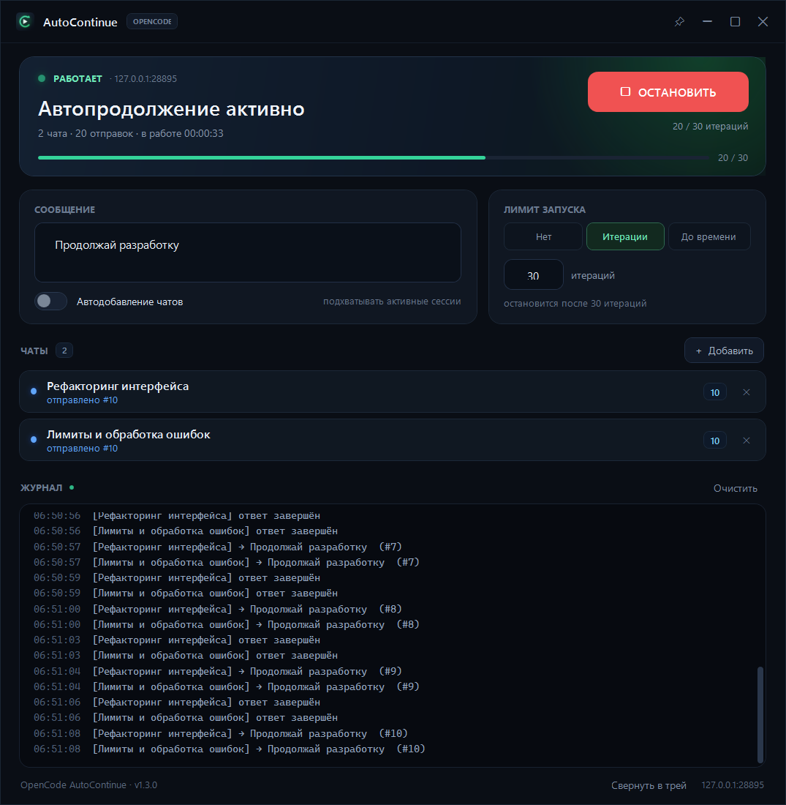
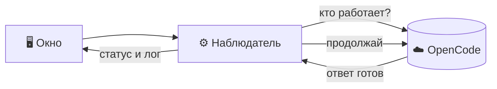

<p align="center">
  
</p>

<h1 align="center">OpenCode AutoContinue</h1>

<p align="center">
  <b>Автопродолжение чатов OpenCode</b><br>
  После каждого ответа бот сам получает «Продолжай разработку» — с лимитами<br>
  и защитой от бесконечного спама ошибками.
</p>

<p align="center">
  
  
  
  
  
</p>

<p align="center">
  <a href="https://github.com/KurumaOfficial/Opencode_Script/raw/main/dist/OpenCodeAutoContinue.exe"><b>⬇ Скачать OpenCodeAutoContinue.exe</b></a>
</p>

---

<p align="center">
  
</p>

## ✨ Что нового в 1.3

| | |
|---|---|
| 🎛 | **Новый интерфейс** — тёмная тема, живые статусы, прогресс лимита и аккуратный журнал |
| ⏱ | **Лимит запуска** — остановиться после N итераций или в заданное время |
| 🛡 | **Защита от спама ошибок** — повторы с паузой, авто-стоп и фоновое переподключение |
| 🖼 | **Новая иконка** — в окне, на панели задач и в трее |
| 📉 | **Ротация журнала** — файл больше не растёт без предела |

## 🚀 Возможности

| | Возможность |
|---|---|
| 🔁 | **Несколько чатов одновременно** — у каждого свой статус и счётчик отправок |
| 🎯 | **Авто-подхват активных чатов** — новый чат появляется в списке сам, как только в нём началась работа |
| 🪪 | **Привязка по `sessionId`** — переименование чата ничего не ломает |
| ✍️ | **Настраиваемый текст** — меняется прямо в окне, применяется сразу |
| ⏱ | **Лимит по итерациям** — например, ровно 50 отправок за запуск |
| 🕒 | **Лимит по времени** — например, до 18:00 (если время прошло — до завтрашнего 18:00) |
| 🧠 | **Умные повторы** — ошибки отправки не долбят API каждую секунду |
| 🔌 | **Авто-переподключение** — OpenCode перезапустился? Утилита подхватит новый порт и пароль |
| ⏸ | **Мгновенная пауза** — одна кнопка, без перезапуска |
| 📌 | **Иконка в трее** — управление доступно даже при свёрнутом окне |
| 🧾 | **Журнал с уровнями** — ошибки, предупреждения и успешные отправки различаются цветом |
| 🛡 | **Один экземпляр** — второй запуск не создаст двойную отправку |

## 📦 Установка

### Вариант 1 — готовый `.exe` *(рекомендуется)*

1. Скачайте [`dist/OpenCodeAutoContinue.exe`](dist/OpenCodeAutoContinue.exe).
2. Положите в любое место и запустите.
3. OpenCode должен быть запущен — утилита работает через его локальный сервис.

> Настройки и журнал хранятся в `%APPDATA%\OpenCodeAutoContinue\`,
> чтобы не мусорить рядом с `.exe`.

### Вариант 2 — из исходников

```powershell
git clone https://github.com/KurumaOfficial/Opencode_Script.git
cd Opencode_Script

# запуск
powershell -ExecutionPolicy Bypass -File AutoContinue.ps1
```

Или просто двойной клик по `Запустить.cmd`.

## 🖥 Как пользоваться

| Элемент | Действие |
|---|---|
| **Текст сообщения** | Что отправлять боту после каждого ответа (можно многострочно) |
| **Автодобавление чатов** | Подхватывать новые активные чаты без ручного добавления |
| **+ Добавить** | Выбрать чат из последних 100 сессий (с поиском) |
| **✕** у чата | Убрать чат и исключить его из авто-добавления |
| **ОСТАНОВИТЬ / ЗАПУСТИТЬ** | Пауза и возобновление работы |
| **НОВЫЙ ЗАПУСК** | Запуск после достижения лимита со сбросом счётчика |
| **Лимит запуска** | `Нет`, `Итерации` или `До времени` |
| **Очистить** | Очистить журнал на экране |
| **Свернуть в трей** | Спрятать окно, оставив утилиту работать |
| **✕** справа вверху | Полный выход из приложения |

### ⏱ Лимиты

**По итерациям.** Укажите число — утилита остановится после стольких
успешных отправок за текущий запуск. Пауза и возобновление счётчик не сбрасывают;
кнопка **НОВЫЙ ЗАПУСК** после срабатывания лимита начинает новый отсчёт.

**До времени.** Укажите `ЧЧ:ММ` (например, `18:00`). Если это время сегодня уже
прошло, лимит будет действовать до завтрашнего `18:00`. Лимит можно менять на ходу:
новое время сразу применяется.

Когда лимит достигнут, утилита ставит автопродолжение на паузу и показывает
`ЛИМИТ` — ничего не отправляется, пока вы не запустите её снова.

### 🛡 Ошибки и переподключение

| Ситуация | Что делает утилита |
|---|---|
| OpenCode не отвечает | Пишет ошибку **один раз**, повторяет с паузами 2 → 4 → 8 → 16 → 30 с |
| 5 ошибок подряд | Ставит автопродолжение на паузу и проверяет связь в фоне каждые 12 с |
| Связь вернулась | Два успешных ответа API — и работа продолжается автоматически |
| OpenCode перезапустился | Перечитывает `service.json` и подхватывает новый адрес/пароль |
| Ошибка отправки в чат | Повтор через 5 → 10 → 20 → 40 → 60 с; после 5 ошибок чат ставится на паузу |
| Бот не начал отвечать за 45 с | Две повторные отправки, затем чат ставится на паузу |
| `HTTP 401/403` | Сразу пауза: устарел пароль сервиса |
| `HTTP 404` | Сессия удалена — чат убирается из списка |

Повторяющиеся ошибки не дублируются в журнале: вы увидите первую ошибку,
пятую попытку и итоговое решение. Журнал на диске ограничен 4 МБ,
старая версия сохраняется как `auto-continue.log.1`.

### Статусы чата

| Статус | Значение |
|---|---|
| `печатает…` | Бот работает, утилита ждёт завершения |
| `ответ получен, ждём отправки` | Ответ закончился, сообщение уйдёт в ближайший тик |
| `отправлено #N` | Сообщение отправлено, ждём ответа |
| `ответ не начался — повтор` | Ответ не начался за 45 с — будет повторная отправка |
| `ошибка отправки — повтор` | Сервер вернул ошибку, повтор отложен |
| `ошибка — чат на паузе` | 5 ошибок подряд, чат больше не трогаем |
| `бот не отвечает` | Три ответа подряд не начались, чат на паузе |

## ⚙️ Настройки

Всё хранится в `settings.json` (создаётся автоматически):

```jsonc
{
  "message": "Продолжай разработку",   // текст, который уходит боту
  "autoAdd": true,                     // подхватывать активные чаты
  "chats": [                           // отслеживаемые чаты
    { "id": "ses_...", "title": "45232" }
  ],
  "ignored": [ "ses_..." ],            // не добавлять автоматически
  "limitMode": "none",                 // none | count | time
  "limitCount": 50,                    // для limitMode = count
  "limitTime": "18:00",                // для limitMode = time
  "topmost": true                      // окно поверх остальных
}
```

Размер окна запоминается автоматически. Утилита считает адрес и пароль сервиса из
`%USERPROFILE%\.local\state\opencode\service.json` — вводить ничего не нужно.
Файл читается как UTF-8, поэтому настройки можно править в любом редакторе.

## 🔧 Как это работает



Ключевые запросы:

| Метод | Назначение |
|---|---|
| `GET /api/session/active` | Кто сейчас работает |
| `GET /api/session/{id}` | Данные сессии (отсекаем под-агентов и архив) |
| `POST /api/session/{id}/prompt` | Отправка сообщения с `delivery: queue` |
| `DELETE` → `404` | Удалённые сессии автоматически убираются из списка |

## 📁 Структура проекта

```
Opencode_Script/
├─ AutoContinue.ps1        # исходник утилиты (WPF, без внешних зависимостей)
├─ Запустить.cmd           # запуск из исходника
├─ build.ps1               # сборка .exe через ps2exe
├─ app.ico                 # иконка приложения (16–256 px)
├─ dist/
│  └─ OpenCodeAutoContinue.exe
├─ docs/
│  ├─ icon.png
│  └─ screenshot.png
├─ settings.example.json   # пример файла настроек
├─ LICENSE
└─ README.md
```

## 🛠 Сборка `.exe`

```powershell
Install-Module ps2exe -Scope CurrentUser
.\build.ps1
```

Скрипт соберёт `dist\OpenCodeAutoContinue.exe`:

- `-noConsole` — без лишнего консольного окна;
- `-STA` — обязательный режим для WPF;
- `-DPIAware` — корректное масштабирование на HiDPI;
- своя иконка, название и версия в свойствах файла.

## ❗ Важные нюансы

**Защита от самозацикливания.** Если утилита работает в том же чате, где её
обсуждают, авто-добавление подхватит этот чат и бот начнёт бесконечно
продолжать сам себя. Такие сессии держите в `ignored` — они попадают туда
кнопкой **✕** у чата и добавляются обратно вручную через **+ Добавить**.

**Каждый ответ = запрос к модели.** Утилита не экономит токены: она
отправляет сообщение после *каждого* завершённого ответа. Пользуйтесь лимитами
и следите за лимитами провайдера.

**Один экземпляр.** Повторный запуск `.exe` не создаст второй наблюдатель —
приложение сообщит, что уже запущено.

### Если что-то не работает

| Симптом | Причина / решение |
|---|---|
| Окно не появилось | Не запущен OpenCode (его фоновый сервис) |
| «Уже запущен» | Приложение уже работает — ищите окно в панели задач или значок в трее |
| Чат не появляется | Включите автодобавление или добавьте вручную |
| Сообщения не уходят | Проверьте журнал `auto-continue.log` |
| Слишком часто отправляет | Задайте лимит итераций или увеличьте `-PollMs` при запуске из исходника |
| После перезапуска OpenCode тишина | Утилита переподключится сама; если нет — нажмите **ПОВТОРИТЬ** |

Лог лежит рядом с настройками: `%APPDATA%\OpenCodeAutoContinue\auto-continue.log`
(старый — `auto-continue.log.1`).

## 📄 Лицензия

Проект распространяется по лицензии [MIT](LICENSE).

<p align="center">
  <sub>Сделано для личного workflow с <a href="https://opencode.ai">OpenCode</a> · Windows 10/11 · PowerShell 5.1</sub>
</p>
