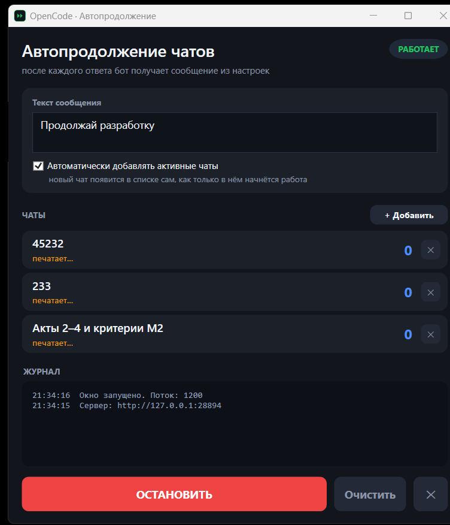
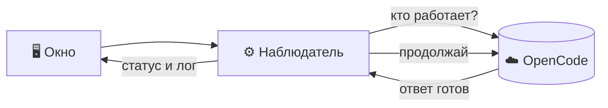

<p align="center">
  
</p>

<h1 align="center">OpenCode AutoContinue</h1>

<p align="center">
  <b>Автопродолжение чатов OpenCode</b><br>
  После каждого ответа бот сам получает «Продолжай разработку» — и так по кругу.
</p>

<p align="center">
  
  
  
  
  
</p>

<p align="center">
  <a href="https://github.com/KurumaOfficial/Opencode_Script/raw/main/dist/OpenCodeAutoContinue.exe"><b>⬇ Скачать OpenCodeAutoContinue.exe</b></a>
</p>

---

<p align="center">
  
</p>

## ✨ Что это

Небольшая утилита для Windows, которая держит разработку в чатах OpenCode
непрерывной. Как только бот заканчивает ответ, утилита отправляет в чат
заданное сообщение — и цикл повторяется, пока вы не нажмёте **ОСТАНОВИТЬ**.

Работает через локальный HTTP API OpenCode, а не через клики по интерфейсу,
поэтому окно OpenCode можно держать свёрнутым или вообще закрыть.

## 🚀 Возможности

| | Возможность |
|---|---|
| 🔁 | **Несколько чатов одновременно** — у каждого свой статус и счётчик отправок |
| 🎯 | **Авто-подхват активных чатов** — новый чат появляется в списке сам, как только в нём началась работа |
| 🪪 | **Привязка по `sessionId`** — переименование чата ничего не ломает |
| ✍️ | **Настраиваемый текст** — меняется прямо в окне, применяется сразу |
| ⏸ | **Мгновенная пауза** — одна кнопка, без перезапуска |
| 📌 | **Иконка в трее** — управление доступно даже при свёрнутом окне |
| 🧾 | **Журнал** — что и когда отправлено, с дублированием в лог-файл |
| 🛡 | **Один экземпляр** — второй запуск не создаст двойную отправку |

## 📦 Установка

### Вариант 1 — готовый `.exe` *(рекомендуется)*

1. Скачайте [`dist/OpenCodeAutoContinue.exe`](dist/OpenCodeAutoContinue.exe).
2. Положите в любое место и запустите.
3. OpenCode должен быть запущен — утилита работает через его локальный сервис.

> Настройки и журнал хранятся в `%APPDATA%\OpenCodeAutoContinue\`,
> чтобы не мусорить рядом с `.exe`.

### Вариант 2 — из исходников

```powershell
git clone https://github.com/KurumaOfficial/Opencode_Script.git
cd Opencode_Script

# запуск
powershell -ExecutionPolicy Bypass -File AutoContinue.ps1
```

Или просто двойной клик по `Запустить.cmd`.

## 🖥 Как пользоваться

| Элемент | Действие |
|---|---|
| **Текст сообщения** | Что отправлять боту после каждого ответа (можно многострочно) |
| **Автоматически добавлять активные чаты** | Подхватывать новые чаты без ручного добавления |
| **+ Добавить** | Выбрать чат из последних 100 сессий |
| **✕** у чата | Убрать чат и исключить его из авто-добавления |
| **ОСТАНОВИТЬ / ЗАПУСТИТЬ** | Пауза и возобновление работы |
| **Очистить** | Очистить журнал на экране |
| **✕** справа внизу | Полный выход из приложения |

### Статусы чата

| Статус | Значение |
|---|---|
| `печатает…` | Бот работает, утилита ждёт завершения |
| `ответ получен…` | Ответ закончился, сообщение уйдёт в ближайший тик |
| `отправлено #N` | Сообщение отправлено, ждём ответа |
| `не запустилось, повтор` | Ответ не начался — будет повторная отправка |
| `ошибка отправки` | Сервер вернул ошибку, подробности в журнале |

## ⚙️ Настройки

Всё хранится в `settings.json` (создаётся автоматически):

```jsonc
{
  "message": "Продолжай разработку",   // текст, который уходит боту
  "autoAdd": true,                     // подхватывать активные чаты
  "chats":   [                         // отслеживаемые чаты
    { "id": "ses_...", "title": "45232" }
  ],
  "ignored": [ "ses_..." ]             // не добавлять автоматически
}
```

Утилита считает адрес и пароль сервиса из
`%USERPROFILE%\.local\state\opencode\service.json` — вводить ничего не нужно.

## 🔧 Как это работает



Ключевые запросы:

| Метод | Назначение |
|---|---|
| `GET /api/session/active` | Кто сейчас работает |
| `GET /api/session/{id}` | Данные сессии (отсекаем под-агентов и архив) |
| `POST /api/session/{id}/prompt` | Отправка сообщения с `delivery: queue` |
| `DELETE` → `404` | Удалённые сессии автоматически убираются из списка |

## 📁 Структура проекта

```
Opencode_Script/
├─ AutoContinue.ps1        # исходник утилиты (WPF, без внешних зависимостей)
├─ Запустить.cmd           # запуск из исходника
├─ build.ps1               # сборка .exe через ps2exe
├─ app.ico                 # иконка приложения
├─ dist/
│  └─ OpenCodeAutoContinue.exe
├─ docs/
│  ├─ icon.png
│  └─ screenshot.png
├─ settings.example.json   # пример файла настроек
├─ LICENSE
└─ README.md
```

## 🛠 Сборка `.exe`

```powershell
Install-Module ps2exe -Scope CurrentUser
.\build.ps1
```

Скрипт соберёт `dist\OpenCodeAutoContinue.exe`:

- `-noConsole` — без лишнего консольного окна;
- `-STA` — обязательный режим для WPF;
- `-DPIAware` — корректное масштабирование на HiDPI;
- своя иконка, название и версия в свойствах файла.

## ❗ Важные нюансы

**Защита от самозацикливания.** Если утилита работает в том же чате, где её
обсуждают, авто-добавление подхватит этот чат и бот начнёт бесконечно
продолжать сам себя. Такие сессии держите в `ignored` — они попадают туда
кнопкой **✕** у чата и добавляются обратно вручную через **+ Добавить**.

**Каждый ответ = запрос к модели.** Утилита не экономит токены: она
отправляет сообщение после *каждого* завершённого ответа. Следите за лимитами.

**Один экземпляр.** Повторный запуск `.exe` не создаст второй наблюдатель —
приложение сообщит, что уже запущено.

### Если что-то не работает

| Симптом | Причина / решение |
|---|---|
| Окно не появилось | Не запущен OpenCode (его фоновый сервис) |
| «Уже запущен» | Приложение уже работает — ищите окно в панели задач или значок в трее |
| Чат не появляется | Включите «Автоматически добавлять активные чаты» или добавьте вручную |
| Сообщения не уходят | Проверьте журнал `auto-continue.log` |
| Слишком часто отправляет | Увеличьте `-PollMs` при запуске из исходника |

Лог лежит рядом с настройками: `%APPDATA%\OpenCodeAutoContinue\auto-continue.log`.

## 📄 Лицензия

Проект распространяется по лицензии [MIT](LICENSE).

<p align="center">
  <sub>Сделано для личного workflow с <a href="https://opencode.ai">OpenCode</a> · Windows 10/11 · PowerShell 5.1</sub>
</p>
