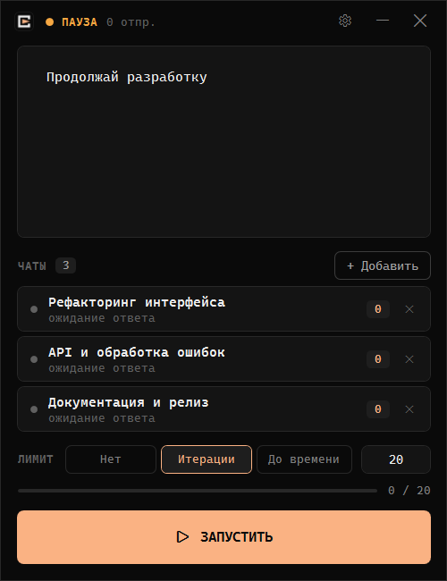
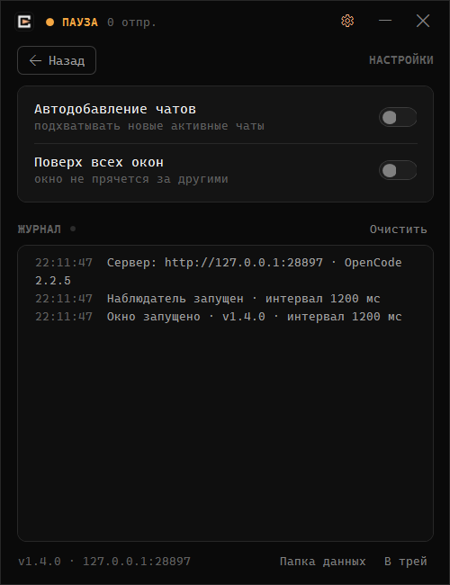

# OpenCode AutoContinue

[English](README.md) | [Русский](README.ru.md)


Небольшая утилита для Windows, которая не даёт сессиям [OpenCode](https://opencode.ai) останавливаться. Когда ассистент заканчивает ответ, она отправляет в эту сессию заранее заданное сообщение, и длинная задача не стоит в ожидании, пока вы напишете «продолжай».

<p>
  
  
</p>

## Что она делает

У OpenCode есть локальный сервис. Утилита опрашивает его и получает список активных сессий. Когда отслеживаемая сессия переходит из состояния «работает» в «свободна», утилита отправляет в неё ваше сообщение. Так продолжается, пока вы не остановите её, не сработает лимит или не пропадёт связь с OpenCode.

Утилита не читает, что написал ассистент, и не может понять, закончена ли задача. Она каждый раз отправляет один и тот же текст, который вы задали.

## Возможности

- Несколько сессий одновременно, у каждой свой статус и счётчик отправок.
- Сессии определяются по ID, поэтому переименование чата ничего не ломает.
- Необязательное автодобавление новых активных сессий (по умолчанию выключено).
- Лимиты запуска: остановка после N сообщений или в заданное время суток.
- Повторы с растущей паузой при ошибках, автопауза после серии сбоев и переподключение, когда OpenCode вернулся, в том числе после перезапуска на другом порту.
- Иконка в трее и защита от запуска второй копии.
- Файл журнала с автоматической ротацией.

## Требования

- Windows 10 или 11.
- Запущенный OpenCode. Утилита работает с его локальным сервисом и без него ничего не делает.
- Для запуска из исходников нужен Windows PowerShell 5.1, он входит в состав Windows. Готовому `.exe` на обычной установке ничего дополнительного не нужно.

## Установка

### Готовый exe

Скачайте [`dist/OpenCodeAutoContinue.exe`](dist/OpenCodeAutoContinue.exe) и запустите.

Файл собран через ps2exe и не имеет цифровой подписи, поэтому часть антивирусов может на него ругаться. Если это мешает, запустите скрипт из исходников или соберите exe сами (см. [Сборка](#сборка)).

### Из исходников

```powershell
git clone https://github.com/KurumaOfficial/Opencode_Script.git
cd Opencode_Script
powershell -ExecutionPolicy Bypass -File AutoContinue.ps1
```

Двойной клик по `Запустить.cmd` делает то же самое без окна консоли.

Необязательные параметры скрипта:

| Параметр | Назначение |
|---|---|
| `-PollMs <n>` | Интервал опроса в миллисекундах. По умолчанию 1200, минимум 500. |
| `-StartStopped` | Запустить в состоянии паузы. |
| `-MessageText <текст>` | Сообщение, если сохранённой настройки ещё нет. |
| `-ChatTitles <a>,<b>` | Чаты для отслеживания по точному названию при первом запуске, пока нет `settings.json`. |

## Использование

Главное окно сверху вниз:

- **Поле сообщения.** Текст, который уходит после каждого ответа. Можно в несколько строк, до 4000 символов. Изменения действуют сразу.
- **Чаты.** Отслеживаемые сессии со строкой статуса, счётчиком отправок и кнопкой удаления. Кнопка `+ Добавить` открывает выбор из 100 последних сессий с поиском. Удалённый чат попадает в список исключений, чтобы автодобавление не вернуло его; повторное добавление через выбор из списка снимает исключение.
- **Лимит.** `Нет`, `Итерации` или `До времени`. Рядом вводится число или время `ЧЧ:ММ`. Тонкая полоска показывает, сколько запуска пройдено.
- **Большая кнопка внизу.** Останавливает и возобновляет работу.

В заголовке окна видно текущее состояние, число сообщений за этот запуск и время работы. Кнопка с шестерёнкой открывает настройки: журнал, автодобавление, «поверх всех окон», кнопка «В трей» и ссылка на папку с данными. `Esc` возвращает на главный экран. Кнопка закрытия завершает программу; чтобы оставить её работать в фоне, нажмите «В трей» в настройках. В меню значка в трее есть пункты «Показать окно», «Остановить»/«Запустить» и «Выход».

Статусы чатов:

| Статус | Значение |
|---|---|
| `ожидание ответа` | Ждём, пока ассистент начнёт работу |
| `печатает…` | Ассистент отвечает, утилита ждёт |
| `ответ получен, ждём отправки` | Ответ закончен, сообщение уйдёт на ближайшем опросе |
| `отправлено #N` | Сообщение номер N отправлено, ждём начала ответа |
| `ответ не начался — повтор` | Ответа нет 45 секунд, сообщение будет отправлено снова |
| `ошибка отправки — повтор` | Сервер вернул ошибку, повтор запланирован |
| `ошибка — чат на паузе` | Пять ошибок отправки подряд, чат на паузе |
| `бот не отвечает` | Три отправки подряд без ответа, чат на паузе |

Чат на паузе возобновляется сам, как только в нём снова начнёт работать ассистент.

### Лимиты

- **Итерации.** Считаются успешно отправленные сообщения за текущий запуск, по всем чатам вместе. Пауза и возобновление счётчик не сбрасывают, а кнопка `НОВЫЙ ЗАПУСК` после срабатывания лимита сбрасывает.
- **До времени.** Вводится `ЧЧ:ММ`. Если это время сегодня уже прошло, остановка наступит завтра в то же время. Значение можно менять во время работы.

Когда лимит достигнут, утилита встаёт на паузу и ничего не отправляет, пока вы не запустите её снова.

### Ошибки и переподключение

| Ситуация | Поведение |
|---|---|
| OpenCode не отвечает | Ошибка пишется в журнал один раз, повторы через 2, 4, 8 и 16 секунд. |
| Пятая ошибка подряд | Пауза и проверка связи в фоне: первая через 8 секунд, дальше каждые 12. |
| Связь вернулась | После двух успешных ответов работа возобновляется сама. |
| OpenCode перезапустили | Утилита заново читает `service.json` и берёт новый адрес и пароль. |
| Отправка в чат не удалась | Повторы через 5, 10, 20 и 40 секунд. Пятая ошибка ставит этот чат на паузу. |
| Нет ответа в течение 45 секунд после отправки | Через небольшую паузу сообщение отправляется снова. Третий такой таймаут подряд ставит чат на паузу. |
| HTTP 401 или 403 при отправке | Немедленная пауза. Пароль сервиса устарел. |
| HTTP 404 при отправке | Сессия удалена, чат убирается из списка. |

Одинаковые ошибки соединения пишутся в журнал один раз, а не при каждой попытке.

## Настройки

Настройки хранятся в `settings.json`. Файл создаётся при первом запуске и перезаписывается программой, поэтому редактируйте его только при закрытом приложении.

| Ключ | Тип | По умолчанию | Назначение |
|---|---|---|---|
| `schema` | число | `2` | Версия формата настроек. Записывается программой. |
| `message` | строка | `Продолжай разработку` | Текст, который отправляется в чаты. |
| `autoAdd` | логический | `false` | Подхватывать новые активные сессии автоматически. |
| `chats` | массив | `[]` | Отслеживаемые сессии в виде `{ "id": "ses_...", "title": "..." }`. Запись с пустым `id` ищется по точному названию. |
| `ignored` | массив | `[]` | ID сессий, которые автодобавление должно пропускать. |
| `limitMode` | строка | `none` | `none`, `count` или `time`. |
| `limitCount` | число | `50` | Лимит сообщений, от 1 до 99999. |
| `limitTime` | строка | `18:00` | Время остановки в формате `ЧЧ:мм`. |
| `topmost` | логический | `true` | Держать окно поверх остальных. |
| `winWidth`, `winHeight` | число | `400`, `520` | Размер окна, запоминается при выходе. |

Пример файла: [`settings.example.json`](settings.example.json).

Где лежит файл:

- При запуске из исходников: рядом с `AutoContinue.ps1`.
- При запуске `.exe`: `%APPDATA%\OpenCodeAutoContinue\`. При первом запуске exe подхватывает `settings.json`, если найдёт его рядом с собой.

Журнал называется `auto-continue.log` и лежит в той же папке. Когда он вырастает больше 4 МБ, он переименовывается в `auto-continue.log.1`, и начинается новый файл.

Настройки версии 1.3 переносятся автоматически: автодобавление выключается, старый размер окна отбрасывается.

## Как это работает

Утилита берёт адрес, пароль и версию локального сервиса OpenCode из `%USERPROFILE%\.local\state\opencode\service.json`, а если файла нет, то из `%LOCALAPPDATA%\opencode\service.json`. Авторизация идёт по HTTP Basic как `opencode:<пароль>`.

| Запрос | Зачем |
|---|---|
| `GET /api/session/active` | Какие сессии работают прямо сейчас. |
| `GET /api/session/{id}` | Сведения о сессии. Сессии субагентов и архивные пропускаются. |
| `GET /api/session?limit=100` | Список сессий для выбора и поиск по названию. |
| `POST /api/session/{id}/prompt` | Отправка сообщения с `delivery: queue`. |

Опрос и отправку выполняет фоновый обработчик. Окно написано на WPF, разметка XAML встроена в скрипт, а с обработчиком окно общается через общее состояние.

## На что обратить внимание

- **Самозацикливание.** Если автодобавление включено и вы работаете в той же сессии, где настраиваете эту утилиту, она подхватит эту сессию и будет продолжать её сама. Оставьте автодобавление выключенным или уберите такие сессии из списка.
- **Каждый ответ стоит запроса.** Утилита отправляет сообщение после каждого завершённого ответа и токены не экономит. Задайте лимит и следите за квотой у провайдера.
- **Один экземпляр.** При запуске второй копии вы увидите уведомление, второй наблюдатель не создаётся.

## Если что-то не работает

| Симптом | Причина или решение |
|---|---|
| Сообщение, что сервис OpenCode не найден | OpenCode не запущен, поэтому файла сервиса нет. |
| «Уже запущено» | Найдите окно на панели задач или значок в трее. |
| Чат не появляется | Включите автодобавление в настройках или добавьте чат кнопкой `+ Добавить`. |
| Сообщения не уходят | Откройте журнал в настройках или файл `auto-continue.log`. |
| Отправляет слишком часто | Задайте лимит итераций или увеличьте `-PollMs` при запуске из исходников. |
| Тишина после перезапуска OpenCode | Утилита переподключается сама. Если нет, нажмите `ПОВТОРИТЬ`. |

## Сборка

```powershell
.\build.ps1
```

Скрипт устанавливает модуль `ps2exe` для текущего пользователя, если его нет, и создаёт `dist\OpenCodeAutoContinue.exe`. Сборка идёт с ключами `-noConsole`, `-STA` (нужен для WPF) и `-DPIAware`, в файл встраиваются `app.ico` и сведения о версии.

## Структура проекта

```
AutoContinue.ps1        приложение (обработчик, окно WPF, трей)
Запустить.cmd           запуск из исходников
build.ps1               сборка exe через ps2exe
app.ico                 иконка приложения, от 16 до 256 px
settings.example.json   пример файла настроек
dist/                   готовый exe
docs/                   иконка и скриншоты
CHANGELOG.md
LICENSE
```

## Лицензия

[MIT](LICENSE)
